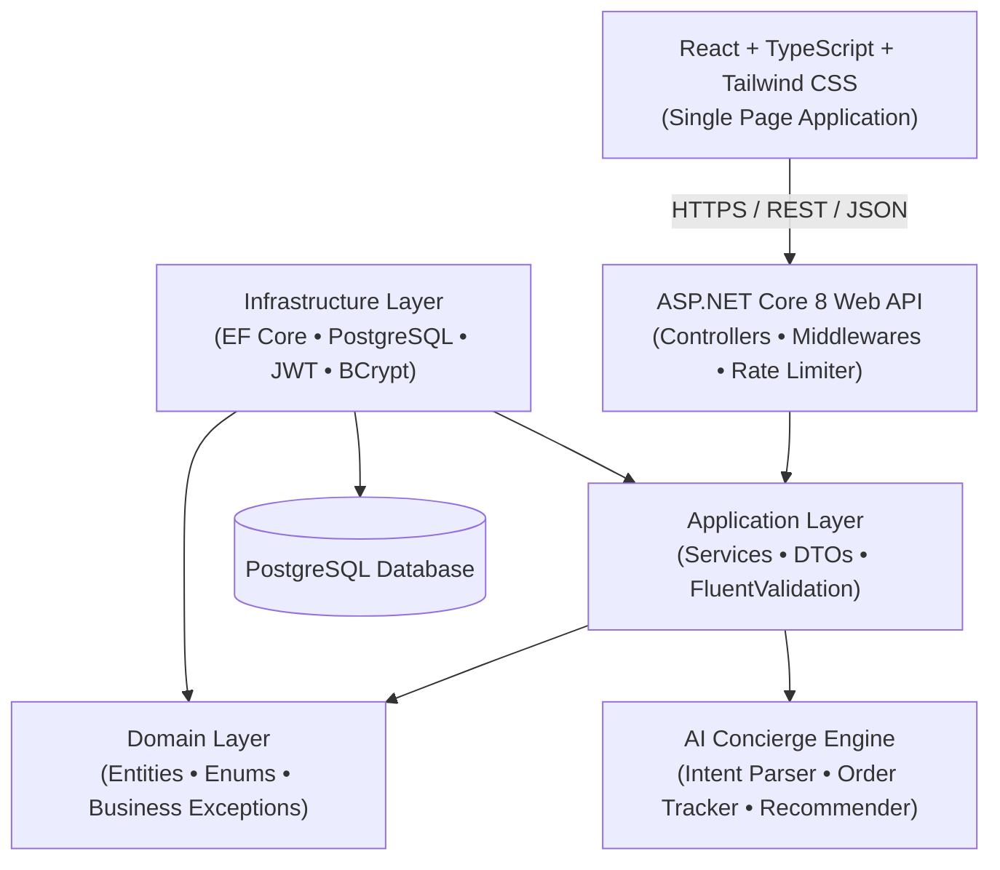

# ShopAI – Intelligent E-Commerce Platform
> **Enterprise-Grade Full-Stack Portfolio Project • Junior Full-Stack Developer • 2026**

[](https://dotnet.microsoft.com/)
[](https://react.dev/)
[](https://www.typescriptlang.org/)
[](https://www.postgresql.org/)
[](https://tailwindcss.com/)
[](https://www.docker.com/)
[](https://github.com/)

---

## 🌟 Executive Summary

**ShopAI** is a production-quality, Full-Stack E-Commerce web application engineered with **Clean Architecture (Modular Monolith)** on **ASP.NET Core 8 Web API** and **React 18 + TypeScript + Tailwind CSS**, backed by **PostgreSQL**.

Unlike simple CRUD showcase apps, ShopAI demonstrates realistic enterprise software engineering practices:
- **Anti-overselling concurrency protection**: Database row-locking and atomic transactional boundaries.
- **Security-first Authentication**: JWT with Refresh Token Rotation, BCrypt hashing, and Role-Based Access Control (`Customer` / `Admin`).
- **Real-Time AI Shopping Concierge**: Conversational support bot providing catalog recommendations with clickable product cards and authenticated live order tracking.
- **Production Observability & Resilience**: Serilog structured logging, RFC 7807 ProblemDetails, FluentValidation, Rate Limiting, and automated database migration/seeding.

---

## 🔑 Demo Accounts (Pre-Seeded)

| Role | Email | Password | Access Capabilities |
|---|---|---|---|
| **Administrator** | `admin@shopai.com` | `Admin@123456` | Full Admin Dashboard, Revenue Analytics, Order Management, Product CRUD, CSV Export |
| **Customer** | `customer@shopai.com` | `Customer@123456` | Shopping bag, Checkout, Verified Purchase Reviews, Wishlist, Order History & Cancellation |

> 💡 **Quick Fill Feature**: The login screen features one-click buttons to automatically fill demo credentials for quick reviewer demonstration!

---

## 🏛️ System Architecture



### Clean Architecture Layer Structure
```
ShopAI/
├── backend/
│   ├── ShopAI.Domain/          # Pure Domain Entities, Enums, Domain Exceptions
│   ├── ShopAI.Application/     # Service Interfaces, DTOs, FluentValidation rules
│   ├── ShopAI.Infrastructure/  # EF Core, PostgreSQL DbContext, JWT, BCrypt, AI Service
│   ├── ShopAI.Api/             # Web API Controllers, ProblemDetails, RateLimiter, Program.cs
│   └── ShopAI.Tests/           # xUnit Unit & Integration Tests (Moq, FluentAssertions)
├── frontend/
│   ├── src/
│   │   ├── components/         # Reusable UI (Navbar, Footer, Modal, Toast)
│   │   ├── features/           # Feature slices (auth, products, cart, orders, admin, chatbot)
│   │   ├── context/            # Global state (Auth, Cart, Wishlist, Toast)
│   │   ├── services/           # Axios API client with automatic token rotation
│   │   └── types/              # Comprehensive TypeScript interfaces
│   └── package.json
├── docs/                       # Architecture, Database ERD, and API specifications
├── .github/workflows/ci.yml    # GitHub Actions CI build & test pipeline
├── docker-compose.yml          # Multi-container orchestration (DB, API, Client)
└── README.md
```

---

## 🚀 Key Functional Modules

### 01 • Authentication & Authorization
- User registration, login, logout, and password management.
- **JWT Access Token** (60 min) + **Refresh Token Rotation** (7 days) with cryptographic token validation.
- Role-Based Access Control (`Admin`, `Customer`) enforced at both API controller and React router boundaries.

### 02 • Product & Category Management
- Categorized product catalog (Laptops, Smartphones, Audio, Smart Home, Accessories).
- Dynamic search, multi-faceted filtering (Category, Price range, In-stock, Minimum rating), and sorting.
- Multi-image gallery, detailed technical specifications, and related products carousel.
- Admin CRUD portal with image upload and inventory adjustment history.

### 03 • Shopping Cart & Checkout
- Persistent cart for authenticated customers; session-based cart for guest shoppers.
- Automatic cart merging upon customer sign-in (`cartApi.merge`).
- Real-time subtotal, shipping calculation (Free over $100), and coupon simulator (`SHOPAI2026`).
- Interactive payment options: Credit Card sandbox, MoMo QR, VNPay QR, and Cash on Delivery (COD).

### 04 • Transactional Order Management (Anti-Overselling)
- **Zero Overselling Guarantee**: Checkout wraps stock validation and decrements in an explicit database transaction (`BeginTransactionAsync`).
- Audit logging: Every stock movement creates an `InventoryTransaction` record.
- Order lifecycle: `Pending` ➔ `Confirmed` ➔ `Shipped` ➔ `Delivered` (or `Cancelled`).
- Customers can cancel orders in `Pending` or `Confirmed` status; inventory is automatically restored.

### 05 • Admin Operations Dashboard
- Real-time KPI metrics: Total revenue, today's turnover, active customers, orders count.
- Interactive 7-day revenue progression chart.
- Low-stock inventory alert tracker (products with stock ≤ 5).
- Status updates with carrier tracking code assignment.
- **Export Orders to CSV** for offline reporting.

### 06 • AI Customer Support Chatbot
- Floating widget available across all storefront pages.
- **Intent Recognition**:
  - Live order tracking by order code (`ORD-YYYYMMDD-XXXXX`).
  - Catalog advisory with interactive mini product cards linking directly to checkout.
  - Policy FAQ answering (shipping rates, 30-day return policy, 12-month warranty).
- Chat session persistence in PostgreSQL and localStorage.

### 07 • Customer Reviews & Wishlist
- 1–5 Star customer ratings with comments.
- **Verified Purchase Protection**: Only customers with delivered orders for a product receive the verified purchase badge.
- Automatic aggregation of average ratings and review counts on product records.
- Personal wishlist with one-click "Move to Bag" action.

---

## 🛠️ Tech Stack Matrix

| Area | Technology | Purpose |
|---|---|---|
| **Backend Framework** | ASP.NET Core 8 Web API | High-throughput asynchronous RESTful API |
| **Architecture** | Clean Architecture / Modular Monolith | Separation of concerns, testability |
| **Database** | PostgreSQL 16+ / 18 | ACID-compliant relational data store |
| **ORM** | Entity Framework Core 8 | Fluent API mappings, migrations, LINQ |
| **Authentication** | JWT + Refresh Token Rotation | Stateless secure session management |
| **Security** | BCrypt.Net-Next | Work factor 11 password hashing |
| **Validation** | FluentValidation | Strongly typed request validation |
| **Logging** | Serilog | Structured JSON logging to console and file |
| **API Documentation** | Swagger / OpenAPI 3.0 | Interactive API explorer with Bearer Auth |
| **Frontend Framework**| React 18 + TypeScript | Type-safe Single Page Application |
| **Styling** | Tailwind CSS 3.4 | Modern SaaS design aesthetic, responsive UI |
| **Icons & Visuals** | Lucide React + Canvas Confetti | Modern iconography & checkout celebration |
| **Testing** | xUnit + Moq + FluentAssertions | Automated service and domain unit tests |
| **Containerization** | Docker & Docker Compose | Multi-container reproducible environments |
| **CI/CD** | GitHub Actions | Automated build, test, and lint workflow |

---

## 💻 Quick Start Guide

### Prerequisites
- [.NET 8 SDK](https://dotnet.microsoft.com/download/dotnet/8.0)
- [Node.js 20+ / npm](https://nodejs.org/)
- [PostgreSQL 16+](https://www.postgresql.org/) (Running on `localhost:5432`)

### 1. Database & Backend Setup
```bash
# 1. Clone repository
git clone https://github.com/your-username/ShopAI.git
cd ShopAI/backend

# 2. Update connection string in ShopAI.Api/appsettings.json if needed
# Default: Host=localhost;Port=5432;Database=shopai_db;Username=postgres;Password=postgres;

# 3. Apply database migrations
dotnet ef database update --project ShopAI.Infrastructure --startup-project ShopAI.Api

# 4. Run the API (Seeds initial admin, customer, categories, products, and orders on startup!)
dotnet run --project ShopAI.Api
```
The API is now running at:
- **API Base**: `http://localhost:5104`
- **Swagger Documentation**: `http://localhost:5104/swagger`

### 2. Frontend Setup
In a new terminal:
```bash
cd ShopAI/frontend

# Install dependencies
npm install

# Start development server
npm run dev
```
The frontend is now available at `http://localhost:5173`!

---

## 🐳 Docker Compose (Single Command Launch)

Launch the entire ecosystem (PostgreSQL, Backend API, and Nginx Frontend) with one command:
```bash
docker-compose up --build
```
- Frontend: `http://localhost`
- Backend API: `http://localhost:5104`
- Database: `localhost:5432`

---

## 🧪 Testing

Execute the backend test suite:
```bash
dotnet test backend/ShopAI.Tests/ShopAI.Tests.csproj
```
Tests cover:
- `OrderServiceTests`: Anti-overselling validation, stock deductions, and cancellation restock.
- `AuthServiceTests`: Duplicate email rejection, password verification, and token generation.

---

## 🎯 Interview Talking Points

1. **Why Modular Monolith over Microservices?**
   - Eliminates distributed transaction failures (Saga complexity), network serialization latency, and container orchestration overhead while preserving clean domain boundaries.
2. **How is overselling prevented?**
   - Check and update statements are guarded within a single database transaction with ACID guarantees and inventory transaction audit logging.
3. **How does Refresh Token Rotation secure sessions?**
   - Refresh tokens are single-use. If a previously consumed token is presented, the system detects a potential replay attack and revokes the session.
4. **How does the AI Assistant add business value?**
   - Converts natural customer queries into direct sales by rendering actionable product cards inside the chat window and reducing support ticket volume via automated order tracking.

---

## 📄 License
This project is licensed under the MIT License. Developed for software engineering portfolio and technical interview demonstrations.
