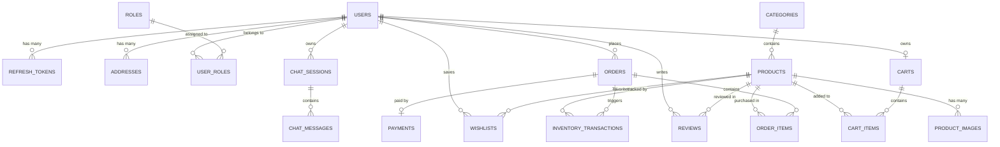

# ShopAI - Database Schema & ERD Documentation

The database is built on **PostgreSQL** managed through **Entity Framework Core 8** migrations with explicit Fluent API constraints, primary keys, foreign keys, cascade rules, precision declarations, and unique indexes.

---

## 1. Entity-Relationship Overview

---

## 2. Table Specifications

### 2.1 Users & Authentication
- **Users**: `Id (UUID PK)`, `Email (Unique Index, VARCHAR 150)`, `PasswordHash (TEXT)`, `FirstName (VARCHAR 50)`, `LastName (VARCHAR 50)`, `PhoneNumber (VARCHAR 20)`, `AvatarUrl (TEXT)`, `IsActive (BOOL)`, `CreatedAt`, `UpdatedAt`.
- **Roles**: `Id (UUID PK)`, `Name (Unique Index, VARCHAR 50)`, `Description (TEXT)`. Seeded with `Admin` and `Customer`.
- **UserRoles**: Composite PK `(UserId, RoleId)`, foreign keys with cascade delete.
- **RefreshTokens**: `Id (UUID PK)`, `UserId (FK)`, `Token (Unique Index)`, `JwtId`, `IsUsed (BOOL)`, `IsRevoked (BOOL)`, `ExpiryDate (TIMESTAMP)`, `CreatedAt`.
- **Addresses**: `Id (UUID PK)`, `UserId (FK)`, `RecipientName`, `PhoneNumber`, `Street`, `Ward`, `District`, `City`, `IsDefault (BOOL)`.

### 2.2 Products & Catalog
- **Categories**: `Id (UUID PK)`, `Name (VARCHAR 100)`, `Slug (Unique Index, VARCHAR 120)`, `Description`, `ImageUrl`, `IsActive`, `DisplayOrder`.
- **Products**: `Id (UUID PK)`, `CategoryId (FK, Restrict)`, `Name (VARCHAR 200)`, `Slug (Unique Index, VARCHAR 250)`, `Sku (Unique Index, VARCHAR 50)`, `ShortDescription (TEXT)`, `Description (TEXT)`, `Price (NUMERIC 18,2)`, `OriginalPrice (NUMERIC 18,2)`, `StockQuantity (INT)`, `IsActive (BOOL)`, `IsFeatured (BOOL)`, `AverageRating (FLOAT)`, `ReviewCount (INT)`.
- **ProductImages**: `Id (UUID PK)`, `ProductId (FK, Cascade)`, `ImageUrl`, `AltText`, `IsPrimary (BOOL)`, `DisplayOrder (INT)`.

### 2.3 Shopping Cart
- **Carts**: `Id (UUID PK)`, `UserId (FK, Unique, Nullable)`, `GuestSessionId (VARCHAR)`, `CreatedAt`, `UpdatedAt`.
- **CartItems**: `Id (UUID PK)`, `CartId (FK, Cascade)`, `ProductId (FK, Cascade)`, `Quantity (INT)`, `UnitPrice (NUMERIC 18,2)`.

### 2.4 Orders, Payments & Inventory Audit
- **Orders**: `Id (UUID PK)`, `OrderNumber (Unique Index, VARCHAR 50)`, `UserId (FK, Restrict)`, `RecipientName (VARCHAR 100)`, `PhoneNumber (VARCHAR 20)`, `ShippingAddress (VARCHAR 300)`, `Status (INT Enum: Pending, Confirmed, Shipped, Delivered, Cancelled)`, `Subtotal (NUMERIC 18,2)`, `ShippingFee (NUMERIC 18,2)`, `DiscountAmount (NUMERIC 18,2)`, `TotalAmount (NUMERIC 18,2)`, `Notes`, `TrackingNumber`.
- **OrderItems**: `Id (UUID PK)`, `OrderId (FK, Cascade)`, `ProductId (FK, Restrict)`, `ProductName`, `ProductSku`, `ProductImageUrl`, `UnitPrice (NUMERIC 18,2)`, `Quantity (INT)`, `TotalPrice (NUMERIC 18,2)`.
- **Payments**: `Id (UUID PK)`, `OrderId (FK, Unique, Cascade)`, `Amount (NUMERIC 18,2)`, `Method (INT Enum: COD, CreditCard, MoMo, VNPay)`, `Status (INT Enum: Pending, Completed, Failed, Refunded)`, `TransactionCode (VARCHAR 50)`, `PaymentDate`.
- **InventoryTransactions**: `Id (UUID PK)`, `ProductId (FK, Cascade)`, `OrderId (FK, Nullable, SetNull)`, `Type (INT Enum: InitialStock, Restock, OrderPlaced, OrderCancelled, ManualAdjustment)`, `QuantityChange (INT)`, `QuantityAfter (INT)`, `Reason (TEXT)`, `CreatedAt`.

### 2.5 Engagement & AI Support
- **Reviews**: `Id (UUID PK)`, `ProductId (FK, Cascade)`, `UserId (FK, Cascade)`, `Rating (INT 1-5)`, `Comment (TEXT)`, `IsApproved (BOOL)`, `IsVerifiedPurchase (BOOL)`.
- **Wishlists**: Composite Unique Index `(UserId, ProductId)`, `CreatedAt`.
- **ChatSessions**: `Id (UUID PK)`, `SessionToken (Unique Index)`, `UserId (FK, Nullable)`, `LastActiveAt`.
- **ChatMessages**: `Id (UUID PK)`, `ChatSessionId (FK, Cascade)`, `Sender (VARCHAR 20)`, `Message (TEXT)`, `MetadataJson (TEXT)`, `CreatedAt`.
